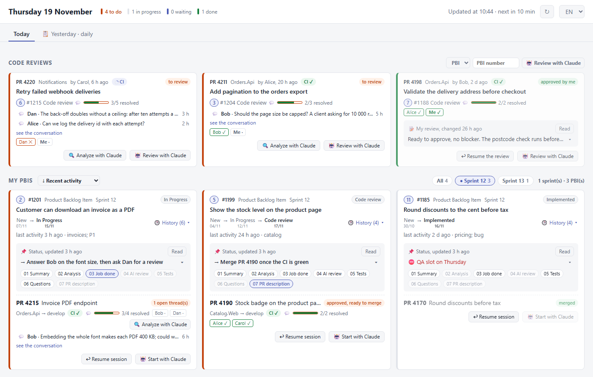
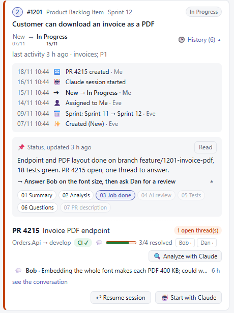

# MySprintDashboard

A local web page that turns Azure DevOps into a to-do list for the day: the pull requests waiting for my review,
and my open PBIs and bugs with their pull requests. Handy for the daily meeting.

The screenshots below use fictional data.



*Today: the pull requests waiting for my review (CI, threads, votes, my review report), then my PBIs in their sprint
backlog order, each with its status, its working-file steps and its pull requests. The colored left edge says what a
card asks of me.*

<p align="center"></p>

*A PBI card unfolded: the state trail and the history timeline, the whole status with the next action, the step
chips, and its pull request with the open thread to answer.*


*Yesterday · daily: what I did on the previous working day, one card per work item or pull request, and a short AI
summary to say at the daily meeting.*

## Files

| File | Role |
| :--- | :--- |
| `dashboard.cs` | The server. A single-file .NET 10 program (minimal API) that calls the Azure DevOps REST API and serves the page. |
| `index.html` | The page. Plain HTML, CSS and JavaScript. It is read again on every request, so you can edit it without restarting the server. |
| `dashboard.settings.json` | The settings of this machine (not committed): copy `dashboard.settings.example.json` and fill it in (below). |
| `<vault>/Reviews/<pr>-review.md` | My review notes, shown on the matching pull request when the file exists. |
| `<vault>/Reviews/<pr>-threads.md` | The analysis of a pull request's unresolved threads, written by an **Analyze with Claude** session. |
| `*.fr.md` next to a report | Its French translation, written when the page is in French (see Languages). |
| `<vault>/PBIs/pbi-<id>/` | The working files of a PBI (`00-status.md` ... `07-pr-description.md`) and `sessions.jsonl`, the Claude sessions the dashboard started for it. |

`<vault>` is a folder (an Obsidian vault in my case) where the PBI working files and the review reports live; the
Claude sessions the dashboard opens get it with `claude --add-dir`, since they run in the workspace (the folder of the
checkouts, the parent of the dashboard folder by default).

## Prerequisites

- The .NET 10 SDK (`dotnet --version` shows 10.x). It runs a lone `.cs` file without a project.
- A personal access token with **Work Items (Read)**, **Code (Read & Write)** (write only to add me as a reviewer) and
  **Build (Read)** in an environment variable (`AZURE_DEVOPS_PAT` unless the settings name another one). The server
  only puts it in the `Authorization` header and never logs it.
- Network access to `dev.azure.com` and to `cdnjs.cloudflare.com` for the markdown libraries.
- For the Claude buttons: Windows Terminal (`wt.exe`), PowerShell 7 (`pwsh`) and Claude Code (`claude`) on the `PATH`.

## Settings

Copy `dashboard.settings.example.json` to `dashboard.settings.json` and fill it in:

| Key | Meaning |
| :-- | :------ |
| `organization` | Azure DevOps organization URL, `https://dev.azure.com/<organization>` |
| `project` | The project of the work items and pull requests |
| `team` | The team whose sprint backlog gives the PBIs' order |
| `vault` | The folder of the PBI working files (`PBIs\`) and the reviews (`Reviews\`) |
| `patVariable` | Optional: the environment variable that holds the PAT (`AZURE_DEVOPS_PAT` by default) |
| `workspace` | Optional: the folder of the checkouts, where the Claude sessions run and git commits are read (the parent folder by default) |

## Run

```powershell
dotnet run dashboard.cs
```

Then open http://localhost:5099. The first start compiles the program, which takes a few seconds. Stop it with Ctrl+C.

The page refreshes every 10 minutes. Use the ↻ button to refresh at once, or `?refresh=<seconds>` to change the
interval (for example http://localhost:5099/?refresh=120).

## Language

The page is in English or French; pick one with the selector at the top right. The choice is kept in the browser
(`localStorage`), and `?lang=en` or `?lang=fr` forces one. Without either, the page follows the browser's language,
and falls back to English.

All texts sit in the `texts` object at the top of the script in `index.html`, one dictionary per language. To add a
language, copy the `en` dictionary under a new code (`de`, ...), translate it, and add an `<option>` to the
`#lang` selector. Data from Azure DevOps (titles, states, work item types) is shown as it is.

## What the page shows

The browser tab shows a checklist icon; when cards are to do, it gets an orange badge with their number and the tab
title starts with it ("(3) Today"), so the tab tells whether something waits without opening it.

The header shows the date and how many cards are **to do** (orange), **in progress** (grey), **waiting** (blue) and
**done** (green); these counters are also the legend of the colored left border of each card, and hovering one
explains its color. Hovering a card's left border names its status and why ("Waiting - PR 57309: waiting for the
reviewers"). The code reviews are sorted by last activity, most recent first. For my PBIs, the
selector between the "My PBIs" title and the sprint chips picks the order, kept in the browser: **Status** puts the
cards to do first, then in progress, waiting and done (recent activity first within each status); **Recent
activity**, the default, sorts by last activity, most recent first:

- a pull request: its creation, its closing, or the last change of any of its threads (comments, votes, pushes and
  policy updates all leave a system thread), and my review file;
- a PBI: its last change in Azure DevOps, the last activity of its pull requests, its working files and its last
  Claude session. The card shows this date ("last activity 3 h ago").

**Backlog order** sorts my PBIs like the team's sprint backlog in Azure DevOps: sprint by sprint, each by its
**Order** column, which the card shows in a blue pill before its id. The server rebuilds that column the way the
backlog does: the sprint's PBIs and bugs of the team's area paths (the `team` of the settings, from its team field values), all
states but Removed (Done included), sorted by Backlog Priority with the unprioritized ones last; an item's order is
its position in that list. A PBI outside the team's areas has no order and goes last. The work items linked to a
pull request in the code reviews show the same pill before their id.

### Daily tab

The **📋 Yesterday · daily** tab (named after the day on a Monday: "Friday · daily") lists what I did on the previous
working day, to prepare the daily meeting. ‹ and › move one working day; the day is loaded when the tab opens and the
↻ button reloads it (`GET /api/daily?day=yyyy-MM-dd`). One card per work item or pull request, newest activity first,
each with the day's events in time order. A work item card shows its order in its sprint backlog (the blue pill, the
number the team uses at the daily) and its sprint; a pull request card shows whose it is ("my PR" or "Alice's PR")
and its linked work items with their order.

**✨ AI summary** asks Claude for a short summary of the shown day to say at the daily: a few bullets, one per task,
each starting with its backlog order and id ("5 #251726 ..."), a PR folded into its work item, a colleague's PR
named after them, in the page language. The server (`POST /api/daily-summary`) gives the day's activity to
`claude -p` (print mode, model `sonnet`, no tool, no MCP server, no saved session) through stdin; it takes about 20
seconds and uses the Claude Code account of the machine. A summary is kept per day and language until the page reloads.

| Source | Events |
| :----- | :----- |
| Work items (`EVER [System.ChangedBy] = @Me` since that day, then their revisions and comments) | my state, sprint and assignment changes, fields I edited, my comments ("Mentioned in !PR" notes that ADO writes are left out) |
| Pull requests I review or wrote, active or closed since that day | PR created or completed by me, my new threads and replies, my votes |
| `git log --all` in the workspace repositories (not the worktrees, which share them), author = the repository's `user.email` | my commits whose message names a PBI (`#251726 ...`) |
| The vault | PBI working files and review reports by their frontmatter `updated` (not the file date, which link passes also change), and the dashboard's Claude sessions |

### Code reviews

Active pull requests where I am a reviewer and not the author. Each card shows:

- the repository, the author and the pull request's age;
- the linked work items and their state;
- the reviewers and their votes (✓ approved, ✕ waiting for author or rejected, · not voted), with my vote in bold;
- the comment threads, as a bar of the resolved share with "resolved/total" (💬 ▰▰▱ 3/5), merge conflicts and the
  CI state;
- my review notes when `Reviews/<pr>-review.md` exists: the `## Verdict` section on the card, folded to its first
  line (▾ unfolds the whole verdict, ▴ folds it back, and an unfolded verdict stays so across refreshes), and the
  whole file in a window opened by **Read**.

### My PBIs

My open Product Backlog Items and Bugs in the project (state not Done, Removed or Closed), each with the pull requests
linked in its Development section. Merged and abandoned pull requests are dimmed.

#### History

Under the title of a PBI, the trail of its states with the date each was reached, the current one in bold
(`New 14/09 → Code review 28/09 → Implemented 01/10 → Testing 07/10`); hover a state for who set it. The
**🕒 History (n)** button on the same line unfolds the whole timeline in the card, newest first:

| Icon | Event | Source |
| :--- | :---- | :----- |
| ✨ ➜ | creation, state change | work item revisions (`_apis/wit/workitems/<id>/updates`) |
| 📅 👤 | sprint change, assignment | work item revisions |
| 🔀 ✅ 🚫 | pull request created, merged, abandoned | the PBI's pull requests |
| 🤖 | Claude session started from the dashboard | `PBIs/pbi-<id>/sessions.jsonl` |

Revisions that change none of these (description, links, comments) are left out. An open timeline stays open
across refreshes. If the revisions of a PBI cannot be read, its history is empty and the rest of the page still
loads (the error goes to the server console).

#### Sprint filter

Chips next to the "My PBIs" title, one per sprint of my PBIs with its number of PBIs, plus **All**. Several sprints
can be on at once; **All** clears the selection. The current sprint of the project's default team
(`_apis/work/teamsettings/iterations?$timeframe=current`) is marked ● and is the selection on first load. The choice
is kept in the browser (`localStorage`); a sprint that no longer has PBIs drops out of it. PBIs without a sprint get
a **No sprint** chip. The filter only applies to my PBIs: the code reviews stay visible whatever their sprint, and
the counters in the header follow what is shown.

### Status of a card

| Status | Pull request I review | My own pull request |
| :----- | :-------------------- | :------------------ |
| To do | I have not voted yet | conflicts, draft, CI failed or expired, open threads, a reviewer waiting for me, or approved and ready to merge |
| Waiting | I voted "waiting for author" | waiting for the reviewers, or approved while the CI still runs |
| Done | I approved | merged or abandoned |

A PBI without an active pull request is **in progress**, or **waiting** when it is On Hold or already in Code review
or Testing.

### Comment threads

Shown on every active pull request, in the code review cards and in the PBI cards. A thread counts once, whatever
its number of replies, and system threads (votes, pushes, policy updates) are left out. A thread is open when
Active or Pending, resolved when Fixed, Closed, By design or Won't fix. The bar fills in green with the resolved
threads over an amber background; hover it for the open and resolved counts.

When threads are open, the card also previews them, one line each (author, start of the first comment, age), two
at most and then "+N more · see the conversations". Clicking a line, that link or the bar opens a popup with every
open conversation in full: the file and line it is on (or "General PR comment"), all its comments rendered as
markdown, and an "open in ADO" link to the thread. The server sends these threads with the rest; it reads them
anyway to count them, so this costs no extra Azure DevOps call.

### CI badge

The state of the **Build** branch policies of the pull request; with several, the worst one wins. The badge links
to the build.

| Badge | Meaning |
| :---- | :------ |
| `CI ✓` | build succeeded |
| spinner `CI` | build queued or running |
| `CI ✕` | build failed |
| `CI expired` | the build expired and has to be queued again |

Code coverage statuses are not shown: they are not blocking policies.

### Claude sessions

Each card has a button that opens an interactive Claude Code session in a new Windows Terminal tab, in the
workspace, with a fixed prompt:

| Button | Prompt |
| :----- | :----- |
| **Review with Claude** (code reviews) | review the pull request and write `Reviews/<pr>-review.md` in the format of the existing reports, without posting a comment or voting |
| **Analyze with Claude** (pull requests with unresolved threads) | for each open thread, sum up the request, check it against the code and propose a reply or a fix, in `Reviews/<pr>-threads.md`, without posting, resolving or changing code |
| **Review with Claude**, box next to the "Code reviews" title, **PBI** selected (`#249499` forces it) | read any PBI, its acceptance criteria and comments, find its pull requests and review them against what it asks, in `PBIs/pbi-<id>/04-ai-review.md`, without commenting, voting or changing the PBI |
| same box, **PR** selected (`!55769` or `PR 55769` force it) | the same review as the button on a code review card, for any pull request, in `Reviews/<pr>-review.md`. First, the server adds me to the PR's reviewers as **optional** (unless I am one already, which would reset my vote), so the PR then shows in my code reviews; the box says "added", "already a reviewer" or "could not add" (hover for the error). Adding a reviewer needs the PAT's **Code (Read & Write)** scope; the review starts either way. |
| **Start with Claude** (my PBIs) | read the PBI, its acceptance criteria and comments, sum up what is asked, list the open questions and propose a plan, with no code before the plan is approved |

#### Languages

The prompts are always in English. The language picked in the page decides the language Claude answers in, and
whether a French copy of the report is written next to the English one, which always exists:

| Page language | Claude answers in | Report files |
| :------------ | :---------------- | :----------- |
| English | English | `<name>.md` |
| French | French | `<name>.md` (English) and `<name>.fr.md` (French, same structure) |

The page shows the report in its own language when that copy exists, the English one otherwise (and a report that
only exists as `<name>.md` whatever its language, like the older French ones). A resumed session keeps the
language it was started with.

#### Review sessions

**Review with Claude** and **Analyze with Claude** pick the session id themselves (`claude --session-id <uuid>`) and
append one line to `Reviews/sessions.jsonl`:

```json
{"pr":56330,"kind":"review","sessionId":"c557080d-...","startedAt":"2026-11-02T10:01:03Z"}
```

The prompt asks the report to start with the session frontmatter (`updated`, `session`, `sessions`). Once a pull
request has a recorded session, **↩ Resume the review** (or **↩ Resume the analysis**) reopens the last one with
`claude --resume <id>`, next to the button that starts a new one. A record may carry a `cwd` (relative to the
workspace): the session is then resumed from that folder, since `claude --resume` only finds a session from the
folder it ran in. The reviews written before this were matched to their sessions from the Claude Code transcripts
and recorded with `"backfilled":true`.

#### PBI sessions and working files

**Start with Claude** and the PBI review pick the session id themselves (`claude --session-id <uuid>`) and append
one line to `PBIs/pbi-<id>/sessions.jsonl` (created on first use):

```json
{"pbi":249499,"kind":"work","sessionId":"3f2c...","startedAt":"2026-10-22T11:30:00+02:00"}
```

A session on a PBI keeps its files in `PBIs/pbi-<id>/`, following the rule "PBI working files" of the workspace
`CLAUDE.md` (so sessions started outside the dashboard do it too):

| File | Content |
| :--- | :------ |
| `00-status.md` | where the PBI stands, created first and kept tiny: frontmatter `step`, `next`, `blockedBy` plus one to three lines |
| `01-summary.md` | what the PBI asks |
| `02-analysis.md` | what has to change and how, with the plan |
| `03-job-done.md` | the work done |
| `04-ai-review.md` | the AI code review (also where the PBI review writes) |
| `05-test-instructions.md` | endpoints, payloads, account (S2S token or user), expected results |
| `06-open-questions.md` | questions for the PO or the team, with their answers |
| `07-pr-description.md` | a PR description ready to paste |

Each file starts with a YAML frontmatter naming the sessions that wrote it (`updated`, `session`, `sessions`). French
copies (`<step>.fr.md`) are written when the page is in French. The card shows `00-status.md` folded to one line:
what blocks (`⛔ blockedBy`, in red), else the next action (`→ next`), else the first line of the text, cut with "…"
(hover for all of it). The ▾ chevron at the end of that line unfolds the whole status (its lines, `→ next` and
`⛔ blockedBy`) and becomes ▴ to fold it back; an unfolded status stays so across refreshes. Then one chip per step, lit when its file exists and outlined for the current `step`; a chip
opens its file, with the sessions that wrote it on top. Claude follows the rule as an instruction, nothing enforces
it: in a long session, remind it to update the status.

Once a PBI has a recorded session, **Resume session** reopens the last one (`claude --resume <id>`) in a new tab.
It stays available when the PBI is Implemented (only **Start with Claude** is disabled then). Sessions started
outside the dashboard are not recorded.

The prompts are `ReviewPrompt`, `ThreadsPrompt`, `PbiReviewPrompt` and `PbiPrompt` in `dashboard.cs`, in English; keep `;` out of them, Windows Terminal reads it
as a command separator. The session runs `claude` (npm install) through `pwsh`, so both must be on the `PATH`
along with `wt.exe`. It is a normal session: permissions are asked as usual. Once a review session has written its
report, the next refresh shows it on the card.

The page calls `POST /api/sessions/<review|pbi|resume>/<id>`. Only the numeric id reaches the prompt, never a title read
from Azure DevOps. The server refuses the call (403) unless the `Origin` is the dashboard itself and the
`X-Dashboard: 1` header is present, so another site open in the browser cannot start a session.

## How it works

`GET /api/today` builds one JSON document on each refresh:

1. `_apis/connectionData` gives my user id (cached for the server's lifetime).
2. A WIQL query lists my open PBIs and bugs; `_apis/wit/workitems?$expand=relations` reads them, and the
   `vstfs:///Git/PullRequestId/...` links give their pull requests.
3. `_apis/git/pullrequests?searchCriteria.reviewerId=<me>&searchCriteria.status=active` lists the pull requests to
   review, and `.../pullRequests/<id>/workitems` their work items.
4. For each pull request: its details, its comment threads (system threads are skipped), its policy evaluations
   (`_apis/policy/evaluations`) for the CI, and the review file from `<vault>/Reviews`.

The page renders the cards. Review notes go through [marked](https://marked.js.org/) and
[DOMPurify](https://github.com/cure53/DOMPurify); without the CDN they are shown as plain text.

## Troubleshooting

| Symptom | Cause |
| :------ | :---- |
| `AZURE_DEVOPS_PAT is not set.` (or the variable of the settings) at start | The variable is missing in this shell. Open a new terminal after setting it. |
| Red banner `(HTML page: PAT rejected or expired?)` | Azure DevOps answered with its sign-in page: the token expired or lacks a scope. |
| Red banner with `400` and `-preview` | An endpoint needs a preview `api-version`; pass it in the path, `WithVersion` keeps it. |
| Port 5099 already in use | Another instance is running. Stop it, or run a second one on another port (below). |
| Build error `MSB3027` (file locked by `dashboard`) | A running instance locks the build output. Stop it first, or build elsewhere (below). |

To try a change while the usual instance keeps running, give the second one its own port and build folder:

```powershell
dotnet run dashboard.cs --artifacts-path $env:TEMP\dashboard-test -- --port 5100
```
