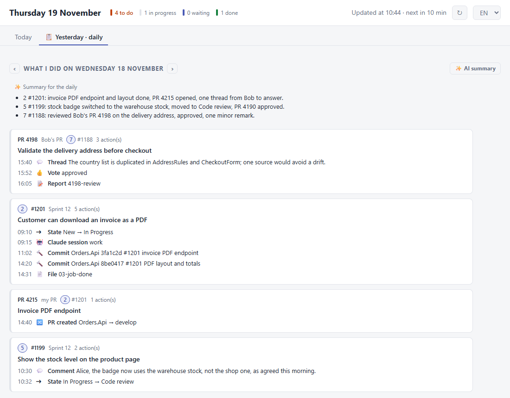

# MySprintDashboard

A local web page that turns Azure DevOps into a to-do list for the day: the pull requests waiting for my review,
and my open PBIs and bugs with their pull requests. Handy for the daily meeting.

The screenshots below use fictional data and show the layout before the revamp (cards in a grid, details unfolded
in the card): they are to be retaken. The page now has one row per item, and a page of its own for a pull request and
for a PBI (see "What the page shows").


<p align="center"></p>



## Files

| File | Role |
| :--- | :--- |
| `dashboard.cs` | The server. A single-file .NET 10 program (minimal API) that calls the Azure DevOps REST API and serves the page. |
| `index.html` | The page. Plain HTML, CSS and JavaScript. It is read again on every request, so you can edit it without restarting the server. |
| `dashboard.settings.json` | The settings of this machine (not committed): copy `dashboard.settings.example.json` and fill it in (below). |
| `<vault>/Reviews/<pr>-review.md` | My review notes, shown on the matching pull request when the file exists. |
| `<vault>/Reviews/<pr>-threads.md` | The analysis of a pull request's unresolved threads, written by an **Analyze with Claude** session. |
| `*.fr.md` next to a report | Its French translation, written when the page is in French (see Languages). |
| `<vault>/PBIs/pbi-<id>/` | The working files of a PBI (`00-status.md` ... `07-pr-description.md`) and `sessions.jsonl`, the Claude sessions the dashboard started for it. |

`<vault>` is a folder (an Obsidian vault in my case) where the PBI working files and the review reports live; the
Claude sessions the dashboard opens get it with `claude --add-dir`, since they run in the workspace (the folder of the
checkouts, the parent of the dashboard folder by default).

## Prerequisites

- The .NET 10 SDK (`dotnet --version` shows 10.x). It runs a lone `.cs` file without a project.
- A personal access token with **Work Items (Read)**, **Code (Read & Write)** (write only to add me as a reviewer) and
  **Build (Read)** in an environment variable (`AZURE_DEVOPS_PAT` unless the settings name another one). The server
  only puts it in the `Authorization` header and never logs it.
- Network access to `dev.azure.com` and to `cdnjs.cloudflare.com` for the markdown libraries.
- For the Claude buttons: Windows Terminal (`wt.exe`), PowerShell 7 (`pwsh`) and Claude Code (`claude`) on the `PATH`.

## Settings

Copy `dashboard.settings.example.json` to `dashboard.settings.json` and fill it in:

| Key | Meaning |
| :-- | :------ |
| `organization` | Azure DevOps organization URL, `https://dev.azure.com/<organization>` |
| `project` | The project of the work items and pull requests |
| `team` | The team whose sprint backlog gives the PBIs' order |
| `vault` | The folder of the PBI working files (`PBIs\`) and the reviews (`Reviews\`) |
| `patVariable` | Optional: the environment variable that holds the PAT (`AZURE_DEVOPS_PAT` by default) |
| `workspace` | Optional: the folder of the checkouts, where the Claude sessions run and git commits are read (the parent folder by default) |

## Run

```powershell
dotnet run dashboard.cs
```

Then open http://localhost:5099. The first start compiles the program, which takes a few seconds. Stop it with Ctrl+C.

The page refreshes every 10 minutes. Use the refresh button to refresh at once, or `?refresh=<seconds>` to change the
interval (for example http://localhost:5099/?refresh=120).

### As an executable

To start the dashboard with a double-click, publish it once as a single executable (it uses the installed .NET 10
runtime) and copy it into this folder, where git ignores it:

```powershell
dotnet publish dashboard.cs -o $env:TEMP\dashboard-publish -r win-x64 -p:PublishAot=false -p:PublishSingleFile=true --self-contained false
Copy-Item $env:TEMP\dashboard-publish\dashboard.exe .
```

With `index.html` next to it, `dashboard.exe` reads the page and `dashboard.settings.json` from its own folder and
opens the browser when it starts; here that is this folder, so a change of the page shows at once. Publish again
after a change of `dashboard.cs`. The executable can live elsewhere with a copy of both files; set `workspace` in
its settings then, if the folder of the checkouts is not the parent of this repository. Without `index.html` next to
it, the executable reads both files from this repository, like `dotnet run`, and does not open the browser. The default native (AOT) publish also works, with the Desktop
Development for C++ workload of Visual Studio installed.

## Language

The page is in English or French; pick one with the selector at the top right. The choice is kept in the browser
(`localStorage`), and `?lang=en` or `?lang=fr` forces one. Without either, the page follows the browser's language,
and falls back to English.

All texts sit in the `texts` object at the top of the script in `index.html`, one dictionary per language. To add a
language, copy the `en` dictionary under a new code (`de`, ...), translate it, and add an `<option>` to the
`#lang` selector. Data from Azure DevOps (titles, states, work item types) is shown as it is.

## What the page shows

The browser tab shows a checklist icon; when rows are to do, it gets an orange badge with their number and the tab
title starts with it ("(3) Today"), so the tab tells whether something waits without opening it.

The header shows the date and how many rows are **to do** (orange), **in progress** (grey), **waiting** (blue) and
**done** (green); hovering a counter explains its status. The page has four views, kept in the address so that a
reload and the browser's back button work:

| View | Address | Content |
| :--- | :------ | :------ |
| Today | `/` | the pull requests waiting for my review, then my PBIs, one row each |
| Daily | `#daily` | what I did on the previous working day |
| Pull request | `#pr/<id>/<tab>` | one pull request: its threads, my review, the analysis of its threads |
| PBI | `#pbi/<id>/<tab>` | one PBI: its working files, its pull requests, its history |

### Today tab

One row per pull request to review and per PBI, in a single column. A row shows, and nothing more:

- a pill with what it asks of me ("To review", "To do", "Waiting"...), in the color of its status;
- what it is: `PR 4220 · repository · author · age`, or `#1201 · state · why` for a PBI ("PR 4215: 1 open thread"),
  with its sprint when the filter shows several;
- its title;
- one sentence: for a pull request, its conflicts, draft state, comment threads ("2 open threads out of 5") and CI;
  for a PBI, what blocks it (`blockedBy` of its status file, in red), else its next action (`next`), else its last
  activity;
- one main button, filled when the row is to do: **Review with Claude** for a pull request (**Read my review** once
  I approved and a review exists), **Resume session** for a PBI (**Start with Claude** when it has no session yet);
- **Details**, which opens the page of the pull request or of the PBI, like the title does.

Rows go by status (to do, in progress, waiting, done), then by last activity, most recent first:

- a pull request: its creation, its closing, or the last change of any of its threads (comments, votes, pushes and
  policy updates all leave a system thread), and my review file;
- a PBI: its last change in Azure DevOps, the last activity of its pull requests, its working files and its last
  Claude session.

A PBI row starts with its **backlog order** in a blue pill, before the status: its position in the team's sprint
backlog in Azure DevOps (the **Order** column). The server rebuilds that column the way the backlog does: the
sprint's PBIs and bugs of the team's area paths (the `team` of the settings, from its team field values), all states
but Removed (Done included), sorted by Backlog Priority with the unprioritized ones last; an item's order is its
position in that list. A PBI outside the team's areas has no order. The same pill shows before the work items of a
pull request on its page, and in the daily.

#### Sprint filter

Chips next to the "My PBIs" title, one per sprint of my PBIs, then **All**. Several sprints can be on at once;
**All** clears the selection. The current sprint of the project's default team
(`_apis/work/teamsettings/iterations?$timeframe=current`) is marked "current" and is the selection on first load.
The choice is kept in the browser (`localStorage`); a sprint that no longer has PBIs drops out of it. PBIs without a
sprint get a **No sprint** chip. The filter only applies to my PBIs: the code reviews stay visible whatever their
sprint, and the counters in the header follow what is shown.

### Daily tab

The **Yesterday · daily** tab (named after the day on a Monday: "Friday · daily") lists what I did on the previous
working day, to prepare the daily meeting. The arrows move one working day; the day is loaded when the tab opens and
the refresh button reloads it (`GET /api/daily?day=yyyy-MM-dd`).

On top, **To say at the daily**: **Write the summary** asks Claude for a short summary of the shown day, a few
bullets, one per task, each starting with its backlog order and id ("5 #251726 ..."), a PR folded into its work item,
a colleague's PR named after them, in the page language. The server (`POST /api/daily-summary`) gives the day's
activity to `claude -p` (print mode, model `sonnet`, no tool, no MCP server, no saved session) through stdin; it takes
about 20 seconds and uses the Claude Code account of the machine. A summary is kept per day and language until the
page reloads.

Below, one card per work item or pull request, newest activity first, each with the day's events in time order. A
work item card shows its backlog order and its sprint; a pull request of mine goes into the card of its work item
when that item has one that day ("with my PR 4215"), so a task reads in one place; another pull request shows whose
it is ("Alice's PR") and its linked work items with their order.

| Source | Events |
| :----- | :----- |
| Work items (`EVER [System.ChangedBy] = @Me` since that day, then their revisions and comments) | my state, sprint and assignment changes, fields I edited, my comments ("Mentioned in !PR" notes that ADO writes are left out) |
| Pull requests I review or wrote, active or closed since that day | PR created or completed by me, my new threads and replies, my votes |
| `git log --all` in the workspace repositories (not the worktrees, which share them), author = the repository's `user.email` | my commits whose message names a PBI (`#251726 ...`) |
| The vault | PBI working files and review reports by their frontmatter `updated` (not the file date, which link passes also change), and the dashboard's Claude sessions |

### Pull request page

Opened from a code review row, or from the pull requests of a PBI. It works for the active pull requests where I am
a reviewer and not the author, and for the pull requests linked to my open PBIs.

The header shows what the pull request asks of me, its repository and target branch, its author and age, its title,
the same sentence as its row (threads, CI), the reviewers with their votes (mine in bold), and its work items with
their backlog order and state (one of my PBIs opens its page). The description of the pull request follows, folded
to four lines. Then the buttons that start or resume a Claude session on it, and three tabs:

| Tab | Content |
| :-- | :------ |
| Comment threads | every open conversation in full: the file and line it is on (or "General PR comment"), all its comments rendered as markdown, and a link to the thread in Azure DevOps. The resolved threads are only counted. |
| My review | `Reviews/<pr>-review.md`, with the same bar as a PBI working file (below). Without a review, what Claude would write and **Review with Claude**. |
| Threads analysis | `Reviews/<pr>-threads.md`, the same way; without one, **Analyze the threads with Claude** when threads are open. |

### PBI page

Opened from a PBI row. It works for my open Product Backlog Items and Bugs in the project (state not Done, Removed
or Closed).

The header shows the backlog order, the status, the id, type, sprint, state, tags and last activity, then the title. The
description written in Azure DevOps follows, with the acceptance criteria, folded to four lines; **Show the whole
description** unfolds it. Then the **next action**: the `next` of `00-status.md` (or the first line of its text),
what blocks it or "Nothing blocks", **Read the status** for the whole file, and **Resume session**.

The tabs are the steps of the work, one per working file of the vault (Summary, Analysis, Job done, AI review,
Tests, Questions, PR description), then **Pull request** when the PBI has some and **History**. A step without a
file is in grey italics; the current `step` of the status is tagged "current step". The page opens on the current
step.

- **A step with a file** shows it, under a bar with its name, its last change, how many sessions wrote it, and:
  - **FR / EN**, when the file has its French copy (`<step>.fr.md`): switches the language shown, for every tab,
    until the page language changes;
  - **Create the French copy**, when it has none: opens a Claude session that writes `<step>.fr.md`;
  - **Run Claude on this step again**: opens a Claude session on this step (see Claude sessions).
- **A step without a file** says what Claude would write there, with **Run Claude on this step**.
- **Pull request** lists the PBI's pull requests, each with what it asks, its sentence and votes, then its open
  conversations in full; the resolved threads are only counted. Merged and abandoned pull requests are dimmed. The
  tab shows as soon as a pull request exists, whatever the state of the PBI, and carries the number of open threads.
- **History** is the timeline of the PBI, newest first:

| Event | Source |
| :---- | :----- |
| creation, state change (in bold) | work item revisions (`_apis/wit/workitems/<id>/updates`) |
| sprint change, assignment | work item revisions |
| pull request created, merged, abandoned | the PBI's pull requests |
| Claude session started from the dashboard | `PBIs/pbi-<id>/sessions.jsonl` |

Revisions that change none of these (description, links, comments) are left out. If the revisions of a PBI cannot be
read, its history is empty and the rest of the page still loads (the error goes to the server console).

### Status of a row

| Status | Pull request I review | My own pull request |
| :----- | :-------------------- | :------------------ |
| To do | "To review": I have neither commented nor voted. "To review again": the author pushed commits or answered after my last comment or vote | conflicts, draft, CI failed or expired, open threads, a reviewer waiting for me, or approved and ready to merge |
| Waiting | "Reviewed, waiting for the author": I commented (or voted "waiting for author") and nothing came after | waiting for the reviewers, or approved while the CI still runs |
| Done | I approved | merged or abandoned |

For a pull request I review, the server reads who acted last from its threads: my last comment or vote, against the
last push (the `RefUpdate` system threads) and the author's last comment. A pull request I reviewed therefore leaves
the "to do" counter by itself, and comes back when there is something new to look at. A push counts whoever made it,
and a vote that a push reset to "no vote" leaves the pull request "to review again".

A PBI takes the most urgent status of its active pull requests. Without an active pull request it is
**in progress**, or **waiting** when it is On Hold or already in Code review or Testing.

### Comment threads and CI

A thread counts once, whatever its number of replies, and system threads (votes, pushes, policy updates) are left
out. A thread is open when Active or Pending, resolved when Fixed, Closed, By design or Won't fix. The server sends
the open threads with the rest; it reads them anyway to count them, so this costs no extra Azure DevOps call.

The CI is the state of the **Build** branch policies of the pull request; with several, the worst one wins: succeeded,
running (queued or running), failed, or expired (the build has to be queued again). The text links to the build.
Code coverage statuses are not shown: they are not blocking policies.

### Claude sessions

A button opens an interactive Claude Code session in a new Windows Terminal tab, in the workspace, with a fixed
prompt:

| Button | Prompt |
| :----- | :----- |
| **Review with Claude** (code review row, pull request page) | review the pull request and write `Reviews/<pr>-review.md` in the format of the existing reports, without posting a comment or voting |
| **Analyze the threads with Claude** (pull request page, pull request of a PBI with unresolved threads) | for each open thread, sum up the request, check it against the code and propose a reply or a fix, in `Reviews/<pr>-threads.md`, without posting, resolving or changing code |
| **Review**, box next to the "Code reviews" title, **PBI** selected (`#249499` forces it) | read any PBI, its acceptance criteria and comments, find its pull requests and review them against what it asks, in `PBIs/pbi-<id>/04-ai-review.md`, without commenting, voting or changing the PBI |
| same box, **PR** selected (`!55769` or `PR 55769` force it) | the same review as the button of a code review row, for any pull request, in `Reviews/<pr>-review.md`. First, the server adds me to the PR's reviewers as **optional** (unless I am one already, which would reset my vote), so the PR then shows in my code reviews; the box says "added", "already a reviewer" or "could not add" (hover for the error). Adding a reviewer needs the PAT's **Code (Read & Write)** scope; the review starts either way. |
| **Start with Claude** (PBI row without a session, PBI page) | read the PBI, its acceptance criteria and comments, sum up what is asked, list the open questions and propose a plan, with no code before the plan is approved |
| **Run Claude on this step** (a step tab of the PBI page) | read the PBI and its working files, then do that one step and write its file: sum up, analyze and plan, carry out the plan (after my approval), review, write the test instructions, list the questions, or write the PR description |
| **Create the French copy** (a file that only exists in English) | write `<name>.fr.md` next to the file, same structure, without changing anything else |

#### Languages

The prompts are always in English. The language picked in the page decides the language Claude answers in, and
whether a French copy of the report is written next to the English one, which always exists:

| Page language | Claude answers in | Report files |
| :------------ | :---------------- | :----------- |
| English | English | `<name>.md` |
| French | French | `<name>.md` (English) and `<name>.fr.md` (French, same structure) |

The page shows a file in its own language when that copy exists, the English one otherwise (and a report that only
exists as `<name>.fr.md`, like the older French ones, as it is). The FR / EN switch of a file overrides this until the
page language changes. A resumed session keeps the language it was started with.

#### Review sessions

**Review with Claude** and **Analyze the threads with Claude** pick the session id themselves
(`claude --session-id <uuid>`) and append one line to `Reviews/sessions.jsonl`:

```json
{"pr":56330,"kind":"review","sessionId":"c557080d-...","startedAt":"2026-11-02T10:01:03Z"}
```

The prompt asks the report to start with the session frontmatter (`updated`, `session`, `sessions`). Once a pull
request has a recorded session, **Resume the review** (or **Resume the analysis**) reopens the last one with
`claude --resume <id>`, on the pull request page. A record may carry a `cwd` (relative to the workspace): the session
is then resumed from that folder, since `claude --resume` only finds a session from the folder it ran in. The reviews
written before this were matched to their sessions from the Claude Code transcripts and recorded with
`"backfilled":true`. A French copy asked from the page is recorded with the kind `review-translate` or
`threads-translate`, which **Resume** ignores.

#### PBI sessions and working files

**Start with Claude**, the PBI review, **Run Claude on this step** and **Create the French copy** pick the session id
themselves (`claude --session-id <uuid>`) and append one line to `PBIs/pbi-<id>/sessions.jsonl` (created on first
use), with the kind `work`, `review`, `step` or `translate`:

```json
{"pbi":249499,"kind":"work","sessionId":"3f2c...","startedAt":"2026-10-22T11:30:00+02:00"}
```

A session on a PBI keeps its files in `PBIs/pbi-<id>/`, following the rule "PBI working files" of the workspace
`CLAUDE.md` (so sessions started outside the dashboard do it too):

| File | Content |
| :--- | :------ |
| `00-status.md` | where the PBI stands, created first and kept tiny: frontmatter `step`, `next`, `blockedBy` plus one to three lines |
| `01-summary.md` | what the PBI asks |
| `02-analysis.md` | what has to change and how, with the plan |
| `03-job-done.md` | the work done |
| `04-ai-review.md` | the AI code review (also where the PBI review writes) |
| `05-test-instructions.md` | endpoints, payloads, account (S2S token or user), expected results |
| `06-open-questions.md` | questions for the PO or the team, with their answers |
| `07-pr-description.md` | a PR description ready to paste |

Each file starts with a YAML frontmatter naming the sessions that wrote it (`updated`, `session`, `sessions`). French
copies (`<step>.fr.md`) are written when the page is in French. `00-status.md` feeds the sentence of the PBI's row
and the next action of its page; the other files are the step tabs of the page. Claude follows the rule as an
instruction, nothing enforces it: in a long session, remind it to update the status.

Once a PBI has a recorded session, **Resume session** reopens the last one (`claude --resume <id>`) in a new tab,
whatever its kind except `translate`: a session that only wrote a French copy is not one to resume. **Start with Claude** stays on the PBI page, next to it, until the PBI is Implemented. Sessions
started outside the dashboard are not recorded.

The prompts are `ReviewPrompt`, `ThreadsPrompt`, `PbiReviewPrompt`, `PbiPrompt`, `StepPrompt` (with what each step
takes in `StepTasks`) and `TranslatePrompt` in `dashboard.cs`, in English; keep `;` out of them, Windows Terminal
reads it as a command separator. The session runs `claude` (npm install) through `pwsh`, so both must be on the
`PATH` along with `wt.exe`. It is a normal session: permissions are asked as usual. Once a session has written its
file, the next refresh shows it.

The page calls `POST /api/sessions/<kind>/<id>`, with `?step=<file name>` for a step or its French copy. Only the
numeric id and a step name checked against the known ones reach the prompt, never a title read from Azure DevOps. The
server refuses the call (403) unless the `Origin` is the dashboard itself and the `X-Dashboard: 1` header is present,
so another site open in the browser cannot start a session.

## How it works

`GET /api/today` builds one JSON document on each refresh:

1. `_apis/connectionData` gives my user id (cached for the server's lifetime).
2. A WIQL query lists my open PBIs and bugs; `_apis/wit/workitems?$expand=relations` reads them, and the
   `vstfs:///Git/PullRequestId/...` links give their pull requests.
3. `_apis/git/pullrequests?searchCriteria.reviewerId=<me>&searchCriteria.status=active` lists the pull requests to
   review, and `.../pullRequests/<id>/workitems` their work items.
4. For each pull request: its details, its comment threads (system threads are skipped), its policy evaluations
   (`_apis/policy/evaluations`) for the CI, and the review file from `<vault>/Reviews`.

The page renders the cards. Review notes go through [marked](https://marked.js.org/) and
[DOMPurify](https://github.com/cure53/DOMPurify); without the CDN they are shown as plain text.

## Troubleshooting

| Symptom | Cause |
| :------ | :---- |
| `AZURE_DEVOPS_PAT is not set.` (or the variable of the settings) at start | The variable is missing in this shell. Open a new terminal after setting it. |
| Red banner `(HTML page: PAT rejected or expired?)` | Azure DevOps answered with its sign-in page: the token expired or lacks a scope. |
| Red banner with `400` and `-preview` | An endpoint needs a preview `api-version`; pass it in the path, `WithVersion` keeps it. |
| Port 5099 already in use | Another instance is running. Stop it, or run a second one on another port (below). |
| Build error `MSB3027` (file locked by `dashboard`) | A running instance locks the build output. Stop it first, or build elsewhere (below). |

To try a change while the usual instance keeps running, give the second one its own port and build folder:

```powershell
dotnet run dashboard.cs --artifacts-path $env:TEMP\dashboard-test -- --port 5100
```
